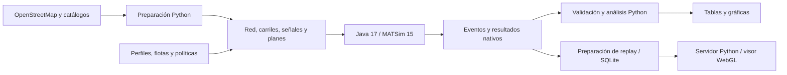

# SimZ1 — Proyecto de Graduación UVG 2026

**Simulación basada en agentes del tráfico urbano en un sector de la Zona 1 de la Ciudad de Guatemala.**

SimZ1 integra una red de OpenStreetMap, demanda sintética, vehículos con distintos perfiles, servicios Transmetro/TuBus y transporte de carga. Utiliza MATSim para la simulación, Python para preparar y analizar datos, y un visor WebGL con consultas SQLite para explorar recorridos y seleccionar vehículos.

Este repositorio contiene el paquete de código y documentación de entrega. **La demanda es sintética y los resultados no representan aforos municipales ni una calibración empírica del tráfico real.** Las corridas históricas, sus bases de datos y sus replays masivos se conservan fuera de esta distribución.

**Verificación de entrega:** compilación limpia Java 17 aprobada; demanda de diez agentes preparada sin QSim; 46 pruebas Python aprobadas y una discrepancia histórica de horario conservada; tres suites JavaScript aprobadas. El [informe de verificación](docs/VERIFICACION.md) explica la evidencia y sus límites.

| Datos académicos | Información |
| --- | --- |
| Autor | Gabriel Estuardo García Donis |
| Carnet | 21352 |
| Institución | Universidad del Valle de Guatemala |
| Trabajo | Proyecto de Graduación 2026 |
| Repositorio oficial | [GraduacionesUVG/2026-21352-garcia-donis-gabriel-estuardo](https://github.com/GraduacionesUVG/2026-21352-garcia-donis-gabriel-estuardo) |
| Fork de entrega | [Gegdgt/2026-21352-garcia-donis-gabriel-estuardo](https://github.com/Gegdgt/2026-21352-garcia-donis-gabriel-estuardo) |

## Objetivo y problema abordado

El objetivo general es desarrollar un entorno de simulación basado en agentes que permita estudiar la interacción del tráfico urbano y explorar escenarios de movilidad en un sector de la Zona 1. El sistema permite observar cómo la demanda, los perfiles vehiculares, la red vial, las señales y los servicios de transporte afectan los recorridos y tiempos de viaje.

El problema abordado es la dificultad de evaluar esas interacciones de forma controlada y reproducible. SimZ1 ofrece escenarios explícitos, semillas registradas, controles de integridad y análisis de resultados para apoyar la experimentación. Sus supuestos y limitaciones deben acompañar cualquier interpretación o comparación.

## Tecnologías y arquitectura

| Tecnología | Función |
| --- | --- |
| Java 17 | Motor e integración de los componentes de simulación |
| MATSim 15.0 | Simulación basada en agentes y eventos nativos |
| Maven 3.9.6 / Maven Wrapper | Compilación y resolución de dependencias |
| Python 3.10+ | Preparación de red y demanda, validadores, análisis y servidores del visor |
| OpenStreetMap, XML y GeoJSON | Red, geometría, restricciones y procedencia cartográfica |
| JSON y CSV | Políticas, flotas, perfiles, manifiestos y tablas |
| SQLite | Consulta de fuentes del replay y recorridos individuales |
| WebGL, deck.gl y JavaScript | Visualización interactiva y selección de vehículos |
| PowerShell | Coordinación de flujos y preparación de la entrega en Windows |
| pytest y Node.js 22+ | Pruebas Python y JavaScript |



Los manifiestos vinculan cada corrida con sus entradas, iteraciones y resultados. Preparar demanda, compilar, completar una simulación, validar resultados y publicar un replay son estados distintos. Un resultado de compilación no demuestra que una corrida histórica haya sido reproducida.

## Estructura de entrega

```text
.
├── capturas/                       Capturas reales que agregará el autor
├── demo/                           Destino del video demo.mp4
├── docs/
│   ├── GUIA_EJECUCION.md            Instrucciones detalladas y límites
│   ├── AUDITORIA_FUENTES.md         Criterios de selección y dependencias
│   ├── VERIFICACION.md              Resultados y alcance de las comprobaciones
│   ├── CHECKLIST_ENTREGA.md         Revisión final y pendientes manuales
│   ├── seleccion_fuentes.csv        Selección revisada con SHA-256
│   ├── inventario_excluidos_completo.csv.gz
│   └── extraccion/                 Informes de vista previa y copia
├── src/                            Raíz ejecutable del proyecto Maven
│   ├── pom.xml
│   ├── mvnw / mvnw.cmd / .mvn/
│   ├── src/main/java/              Código Java de producción
│   ├── src/main/resources/         Políticas y recursos Java
│   ├── src/test/java/              Pruebas Java
│   ├── python/                     Preparación, análisis, visor y pruebas
│   ├── scripts/                    Lanzadores y utilidades
│   ├── scenarios/                  Entradas y configuraciones del escenario
│   ├── tests/                      Fixtures y pruebas
│   ├── docs/                       Documentación técnica original
│   ├── requirements.txt
│   ├── requirements-test.txt
│   └── README.md                   README original conservado
├── preparar_entrega_simz1.ps1       Extracción reproducible desde el desarrollo
├── .gitattributes                  Preservación de bytes de fuentes protegidas
├── .gitignore
└── README.md
```

La selección inicial comprende **937 archivos de origen y 131,191,301 bytes, aproximadamente 125.11 MiB**. Incluye entradas OSM/XML legítimas y fixtures mínimas necesarias, además del código. El inventario describe cada archivo; no se copió el árbol de desarrollo completo.

El segundo nivel `src/src/` es deliberado: el primero cumple la estructura UVG y el segundo conserva la estructura Maven original. Las instrucciones vigentes para esta entrega son este README y la [guía de ejecución](docs/GUIA_EJECUCION.md). El README y las bitácoras del proyecto original contienen referencias históricas que pueden depender de resultados excluidos.

## Instalación y preparación del entorno

El flujo documentado utiliza Windows y PowerShell. Instale un **JDK 17 completo**, **Python 3.10 o superior** y, para ejecutar pruebas JavaScript, **Node.js 22 o superior**. Se requiere acceso a los repositorios Maven/Python durante la instalación y al CDN del visor cuando se use WebGL. El wrapper evita tener que instalar Maven por separado.

Para Java, descargue el paquete **JDK 17** de [Eclipse Temurin](https://adoptium.net/temurin/releases/?version=17), seleccione Windows y la arquitectura de su equipo e instálelo. Para Python, use el instalador de [Python para Windows](https://www.python.org/downloads/windows/) y habilite su acceso desde la terminal. Abra una terminal nueva después de instalar. La validación de esta entrega utilizó Python 3.10.11; no se comprobó cada versión posterior admitida por los requisitos originales.

Abra PowerShell en la raíz del repositorio descargado. Entre al proyecto Maven y configure la ruta real de su JDK:

```powershell
Set-Location .\src
$env:JAVA_HOME = Read-Host 'Ruta de la carpeta del JDK 17 instalado'
$env:Path = (Join-Path $env:JAVA_HOME 'bin') + ';' + $env:Path
java -version
javac -version
python --version

python -m venv .venv
if ($LASTEXITCODE -ne 0) { throw 'No se pudo crear el entorno Python.' }
& .\.venv\Scripts\python.exe -m pip install -r requirements-test.txt
if ($LASTEXITCODE -ne 0) { throw 'Instalacion de dependencias incompleta.' }
& .\.venv\Scripts\python.exe -m pip check
if ($LASTEXITCODE -ne 0) { throw 'Hay dependencias incompatibles.' }
```

Todos los comandos de ejecución siguientes parten de esa carpeta `src/`. No hace falta activar el entorno: se invoca su Python explícitamente. Las dependencias originales se encuentran en [requirements.txt](src/requirements.txt) y [requirements-test.txt](src/requirements-test.txt). SQLite viene con Python; los entornos virtuales y las cachés de la máquina del autor se excluyen.

El lanzador de simulación establece un heap Java de 12 GiB cuando detecta al menos 16 GiB de RAM, y de 8 GiB en otro caso. Considere también memoria para el sistema y espacio para resultados. Los límites de espacio de los experimentos grandes permanecen en sus lanzadores originales.

## Compilación con Maven

```powershell
& .\mvnw.cmd --batch-mode --no-transfer-progress -DskipTests test-compile
if ($LASTEXITCODE -ne 0) { throw 'Fallo la compilacion; revisar la salida de Maven.' }
& .\.venv\Scripts\python.exe -B .\python\check_simz1_install.py --tests
if ($LASTEXITCODE -ne 0) { throw 'Hay requisitos de instalacion pendientes.' }
```

`test-compile` compila producción y pruebas; no ejecuta MATSim ni acredita haber ejecutado las pruebas Java. La [guía](docs/GUIA_EJECUCION.md) añade la verificación del classpath y del bytecode objetivo 17. El [informe de verificación](docs/VERIFICACION.md) registra las comprobaciones realmente realizadas, sus resultados y cualquier dependencia pendiente.

## Preparar la red y una demanda pequeña

El extracto OSM, la red, los carriles, las señales y las configuraciones necesarias están incluidos. Para inspeccionar la conversión OSM en una carpeta nueva, use `python/prepare_simz1.py --input ... --output-dir ...` según la [guía](docs/GUIA_EJECUCION.md). La conversión básica no reconstruye por sí sola todas las revisiones del experimento final; no debe reemplazar las entradas revisadas.

Este ejemplo prepara **diez agentes** con un catálogo existente de carros y motos, sin ejecutar MATSim:

```powershell
$demanda = Join-Path (Get-Location).Path ('runtime\entrega-demanda-10-' + [guid]::NewGuid().ToString('N'))
& .\.venv\Scripts\python.exe -B .\python\generate_montecarlo_z1.py `
    --config .\scenarios\zona1\config-simz1.xml --run-dir $demanda `
    --agents 10 --seed 20261120 --matsim-seed 20261120 `
    --corridor-policy redistribute --origin-policy uniform-nodes-v1 `
    --agent-catalog .\scenarios\zona1\agent-types-car-moto-v1.json
if ($LASTEXITCODE -ne 0) { throw 'Fallo la preparacion; no continuar a MATSim.' }
Get-Content -LiteralPath (Join-Path $demanda 'run-manifest.json')
```

El resultado `prepared` indica entradas preparadas. No acredita movimiento de vehículos ni resultados simulados. Este ejemplo pequeño no representa la composición y las flotas de los experimentos finales. Las configuraciones de Transmetro/TuBus y camiones se conservan en `scenarios/zona1/transit/`, `freight/`, `od/` y `experiments/`; sus contratos y supuestos se describen en la [auditoría de fuentes](docs/AUDITORIA_FUENTES.md).

## Simulación de prueba: comando para ejecución posterior

**Este comando sí lanza MATSim/QSim y no se ejecutó durante la preparación de la entrega.** Crea una corrida nueva de diez agentes y una iteración. Debe usarse únicamente cuando se decida ejecutar una simulación después de revisar el entorno.

```powershell
$corrida = Join-Path (Get-Location).Path ('runtime\entrega-simulacion-10-' + [guid]::NewGuid().ToString('N'))
& .\.venv\Scripts\python.exe -B .\python\ejecutar_simz1.py `
    --config .\scenarios\zona1\config-simz1.xml --run-dir $corrida `
    --agents 10 --seed 20261120 --matsim-seed 20261120 --iterations 1 `
    --corridor-policy redistribute --origin-policy uniform-nodes-v1 `
    --agent-catalog .\scenarios\zona1\agent-types-car-moto-v1.json
if ($LASTEXITCODE -ne 0) { throw 'Revisar manifiesto y log; conservar la corrida.' }
```

El lanzador modifica únicamente la configuración de su corrida nueva. El maestro conserva 50 iteraciones; no se debe usar directamente como equivalente de este ejemplo. Las corridas 1K, 10K y 55K no se regeneraron ni se validaron nuevamente como parte de esta entrega.

## Revisar resultados, generar gráficas y abrir el visor

Los siguientes comandos requieren una corrida ya ejecutada. `$corrida` debe identificar su carpeta concreta, y la iteración 0 debe existir. Compruebe primero el estado nativo:

```powershell
$estado = Get-Content -Raw -Encoding UTF8 -LiteralPath (Join-Path $corrida 'run-manifest.json') | ConvertFrom-Json
$estado | Select-Object run_id,status,phase,iterations,validation
Get-Content -LiteralPath (Join-Path $corrida 'matsim-run.log') -Tail 40
if ($estado.status -ne 'completed' -or $estado.validation.status -ne 'valid') {
    throw 'La corrida no esta completed/valid; conservar y diagnosticar.'
}
& .\.venv\Scripts\python.exe -B .\python\generar_graficas_z1.py `
    --run-dir $corrida --iteration 0 --profiles-only
if ($LASTEXITCODE -ne 0) { throw 'Fallo el analisis; no repetir QSim por este error.' }
& .\.venv\Scripts\python.exe -B .\scripts\replay\prepare_replay.py `
    --run-dir $corrida --iteration 0 --sqlite-budget-gib 8 --scratch-budget-gib 4
if ($LASTEXITCODE -ne 0) { throw 'Replay incompleto; conservar sus archivos.' }
powershell.exe -NoProfile -ExecutionPolicy Bypass -File .\scripts\replay\start_replay.ps1 `
    -RunDir $corrida -Iteration 0 -Port 8792
if ($LASTEXITCODE -ne 0) { throw 'No se pudo abrir el replay solicitado.' }
```

El análisis produce tablas y gráficas en `analysis/it.0/`, con productos por perfil en `graficas_perfiles/`. El preparador del replay procesa resultados existentes y crea o reutiliza una fuente SQLite compatible. El servidor abre el navegador al comprobar la identidad del replay; mantenga la terminal abierta y use Ctrl+C para cerrarlo. Los presupuestos SQLite y temporales son límites, no garantías de espacio para corridas grandes.

En el visor se puede pausar, navegar en el tiempo, filtrar tipos y rutas, y **hacer clic sobre un vehículo para consultar sus datos y recorrido**. Las posiciones y velocidades visuales interpoladas se distinguen de los eventos nativos. La [guía completa](docs/GUIA_EJECUCION.md) explica el procesamiento de eventos, selección, consultas, recuperación del análisis y condiciones de funcionamiento.

El visor genérico entregado permite preparar replays de nuevas corridas. Las interfaces finales específicas de Run1000/Run10K usan adaptadores, recibos y datos históricos adicionales bajo `runtime/diagnostics/`. **Un clon de este repositorio no abre Run10K ni reproduce su interfaz final sin ese paquete externo.** Los lanzadores históricos y generadores de gráficas de tesis se conservan como fuentes, con sus dependencias documentadas; no se presentan como flujos disponibles sin esos datos.

## Archivos excluidos y reproducción de resultados existentes

Se excluyen el Git del origen, entornos virtuales, `node_modules`, compilados, cachés, corridas anteriores, eventos masivos, SQLite voluminosas, runtime histórico, diagnósticos generados, respaldos y copias de gráficas/replays. No se incorporan archivos `.env` reales ni credenciales. Las exclusiones se deciden por función y dependencias, no solamente por extensión.

Para revisar resultados históricos se requiere un paquete íntegro con manifiesto original, entradas y salidas referenciadas, eventos y planes de la iteración elegida, y, para el visor, su fuente SQLite, manifiestos y recursos asociados. Sus hashes y recibos deben conservarse. **No se ha establecido un enlace público de descarga para ese paquete.** La alternativa disponible en el repositorio es crear una corrida nueva con sus insumos y generadores; eso no demuestra reproducción de una corrida aceptada.

- [Auditoría de fuentes y decisiones de distribución](docs/AUDITORIA_FUENTES.md).
- [Selección de fuentes con tamaños y SHA-256](docs/seleccion_fuentes.csv).
- [Inventario completo de excluidos, CSV comprimido](docs/inventario_excluidos_completo.csv.gz).
- [Informes de extracción](docs/extraccion/).
- [Resultados y límites de la verificación](docs/VERIFICACION.md).

El extracto OSM conserva su atribución a OpenStreetMap contributors y su procedencia ODbL en `src/scenarios/zona1/osm-source.json`. Las demás fuentes cartográficas y municipales se describen en sus metadatos y en la auditoría. No se atribuye una licencia inexistente en esos metadatos.

## Extracción reproducible desde el proyecto de desarrollo

El script [preparar_entrega_simz1.ps1](preparar_entrega_simz1.ps1) se ejecuta desde la raíz UVG, un nivel arriba de la raíz Maven. Su vista previa es el comportamiento predeterminado:

```powershell
# Desde la raiz UVG, donde esta este README:
powershell.exe -NoProfile -ExecutionPolicy Bypass -File .\preparar_entrega_simz1.ps1

# Aplicar la seleccion revisada, cuando corresponda:
powershell.exe -NoProfile -ExecutionPolicy Bypass -File .\preparar_entrega_simz1.ps1 -Aplicar
```

Sus parámetros `-Origen` y `-Destino` permiten indicar rutas explícitas. Por defecto lee el proyecto de desarrollo original indicado por el autor y usa como destino la carpeta del script. Valida que sean rutas separadas, que el destino corresponda al fork personal y que los archivos coincidan con la selección revisada. Bloquea archivos sensibles, archivos de más de 25 MiB y diferencias que requieran revisión.

La copia conserva la estructura Maven y los bytes de las fuentes. No borra archivos del origen, no sobrescribe destinos diferentes, no modifica capturas/video/documentos manuales y puede repetirse sin duplicar carpetas. Emite inventarios e informes bajo `docs/extraccion/`. No ejecuta simulaciones, no hace commit ni push y no crea un Pull Request. Quien solo descargue el paquete para utilizarlo no necesita disponer del proyecto original ni ejecutar este extractor.

## Capturas, video e informe final

Estos materiales se agregarán manualmente. Los enlaces muestran sus destinos previstos; los archivos pendientes no se presentan como entregados.

| Material | Destino | Estado |
| --- | --- | --- |
| Capturas reales del software | [capturas/](capturas/) | **Pendiente:** agregar al menos diez capturas reales |
| Video demostrativo | [demo/demo.mp4](demo/demo.mp4) | **Pendiente:** copiar el video |
| Tesis definitiva | [docs/informe_final.pdf](docs/informe_final.pdf) | **Pendiente:** copiar el PDF final |
| Consentimiento firmado | [docs/consentimiento_firmado.pdf](docs/consentimiento_firmado.pdf) | **Pendiente:** copiar el documento firmado |

No se han creado capturas, videos, tesis ni firmas de muestra. El [checklist de entrega](docs/CHECKLIST_ENTREGA.md) reúne estos cuatro pendientes y los pasos de revisión y publicación autorizada.

## Limitaciones y trabajo futuro

La demanda, composición y varios parámetros son supuestos explícitos de simulación. La cartografía y su conversión tienen limitaciones documentadas; no equivalen a una verificación GIS exhaustiva ni a observaciones actuales de circulación. La configuración de flotas y horarios requiere conservar la versión y los supuestos de cada experimento.

La entrega no acredita repetir resultados históricos y la comprobación del visor en un navegador requiere datos compatibles. Los análisis deben distinguir viajes completos, incompletos y censurados; una prueba de diez agentes es una verificación funcional, no una base estadística para conclusiones de movilidad.

El trabajo futuro incluye calibrar y contrastar el modelo con datos observados, ampliar la validación de red y servicios, mejorar la evaluación de rendimiento y memoria del replay, y preparar paquetes externos verificables para compartir los resultados voluminosos. Cualquier ampliación debe mantener procedencia, criterios de aceptación e identificación de las corridas.
